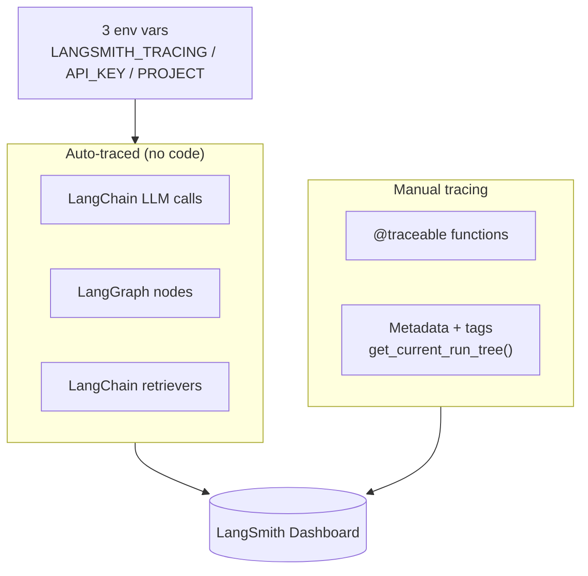
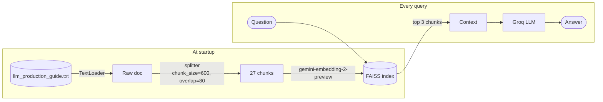
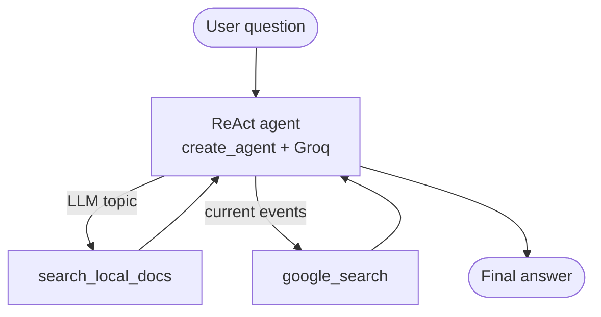
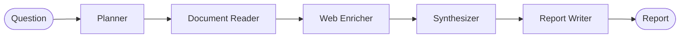

# LangSmith: LLM Tracing & Observability

## What is LangSmith?

LangSmith is an observability platform made by LangChain. Once you turn it on, every LangChain / LangGraph call is logged automatically.

```
Without LangSmith:  llm.invoke("What is RAG?")  ->  just the answer

With LangSmith:     llm.invoke("What is RAG?")  ->  the answer PLUS
                      model, input/output tokens, latency,
                      full prompt, full response, cost
```

### Why it's useful

| Problem in production | How LangSmith helps |
|-----------------------|---------------------|
| "Why did the LLM give a bad answer?" | Shows the exact prompt, including retrieved context |
| "Which users cost the most tokens?" | Filter by `metadata.user_id` and sum tokens |
| "Is my agent looping or using the wrong tool?" | Every tool call and reasoning step is a visible child run |
| "How slow are my calls?" | Latency is recorded per run |
| "What changed since yesterday?" | Compare runs over time using tags and metadata |

## How tracing works


### Exp 1: Auto-tracing

```python
from langchain_groq import ChatGroq

llm = ChatGroq(model="openai/gpt-oss-120b", temperature=0.3)
response = llm.invoke("What is a LangSmith Run? Answer in 2 sentences.")
```

Nothing extra is needed. The run just shows up in the dashboard.

### Exp 2: `@traceable`

```python
from langsmith import traceable

@traceable(run_type="tool", name="doc_keyword_search")
def search_document(query: str, top_k: int = 3) -> list:
    ...

@traceable(run_type="chain", name="doc_qa_pipeline")
def doc_qa(question: str) -> str:
    sections = search_document(question)   
    context = "\n\n".join(sections)
    prompt = f"Context:\n{context}\n\nQuestion: {question}\nAnswer concisely:"
    return llm.invoke(prompt).content      
```

Without `@traceable` LangSmith only sees the LLM call. With it, I see the whole function as the parent and the LLM call nested inside.

### Exp 3: Tags & metadata

```python
from langsmith import traceable, get_current_run_tree

@traceable(run_type="chain", name="support-query")
def support_qa(question: str, user_id: str, session_id: str) -> str:
    run = get_current_run_tree()
    if run:
        run.metadata.update({"user_id": user_id, "session_id": session_id})
        run.tags = ["production", "support-bot", "groq"]
    return llm.invoke(question).content
```

In a real app I could filter by `metadata.user_id` to see one user's traces and total their token cost.

### Exp 4: Traced RAG



The RAG function is wrapped in `@traceable`, and I attach `user_id` and `chunks_retrieved` as metadata. In LangSmith I can open the LLM run and see the full prompt with the retrieved chunks.

### Exp 5: Multi-tool ReAct agent

The agent chooses between two tools:

- `search_local_docs`: searches the FAISS index of the LLM production guide
- `google_search`: live web results through Google Serper



```python
agent = create_agent(
    model=llm,
    tools=[search_local_docs, google_search],
    system_prompt="..."
)

result = agent.invoke(
    {"messages": [HumanMessage(content=question)]},
    config={"recursion_limit": 10},
)
```

Test queries I tried:

| Query | Expected tools |
|-------|----------------|
| What are LLM prompt injection attacks? | `search_local_docs` only |
| What are the latest AI regulations in 2025? | `google_search` only |
| How does RAG work and what are the latest open-source RAG frameworks? | both |

---

## The Streamlit app: Document Intelligence Agent

A 5-node sequential LangGraph agent. Every question goes through all 5 nodes in order and comes out as a structured report.



| Node | Model / Tool | What it does |
|------|--------------|--------------|
| Planner | Groq | Rewrites the question so retrieval works better |
| Document Reader | keyword search | Searches `llm_production_guide.txt` |
| Web Enricher | Google Serper | Adds live web info the local guide doesn't have |
| Synthesizer | Groq | Merges document + web results into one analysis |
| Report Writer | Gemini | Formats the TL;DR, bullets and conclusion |

The nice part: there is **no tracing code in `agent/nodes.py`**. LangGraph + the LangSmith env vars trace every node automatically. With Logfire I'd have to wrap each node in a manual span.

Sample questions:

```
What are the biggest LLM security risks in production?
How does RAG reduce hallucinations and what are the best RAG frameworks?
Best practices for monitoring LLM costs at scale?
Latest developments in AI agent frameworks in 2025?
```

---

## Project structure

```
langsmith observability/
├── langsmith_basics.ipynb
├── app.py
├── agent/
│   ├── state.py        # AgentState TypedDict
│   ├── tools.py        # search_document() keyword search
│   ├── nodes.py        # 5 node functions
│   └── graph.py        # sequential StateGraph
├── data/
│   └── llm_production_guide.txt
├── requirements.txt
└── .env                # NOT committed
```

## Credits

Course: *Production-Grade LLM Engineering*, Module 4 (instructor: Divesh).
Built with LangChain, LangGraph, LangSmith, Groq, Gemini, FAISS, Google Serper and Streamlit.